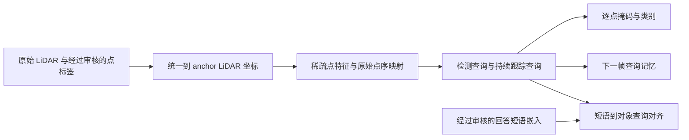

# 回答绑定的 4D 实例分割：独立训练路径

该训练路径依据九篇论文研究报告的机制，迁移到 B4DL/nuScenes。原始报告为 `E:/Download/seg-deepsearch.md`。

这是独立训练原型，具体云端运行记录保存在 `training_logs/`。新入口不导入 B3/Vicuna，不修改 B3 的数据、投影器、LoRA 和训练入口。mini 训练用于先验证空间掩码路径，不能作为完整 nuScenes 的独立性能验收。

## 九篇论文分别对应什么

| 论文 | 对当前任务的执行方法 | 本轮实现范围 |
| --- | --- | --- |
| MaskPLS | 先学习整帧实例集合：query → 点级掩码/类别；用集合匹配监督 | 独立稀疏 U-Net、位置特征、掩码注意力、匈牙利匹配、BCE/Dice/类别损失 |
| Mask4D | 让已匹配实例的查询跨帧继续解码，加入时间、位置、运动和错误实例负约束 | 时间有序 clip、持续查询、按秒设置生命周期、预测位置先验、固定身份匹配及其他实例前景抑制 |
| Grounded 3D-LLM | 将回答短语与具体对象查询对齐；先独立训练对齐头 | 可选短语嵌入到查询的对齐头，明确的无目标候选，已审核短语—实例对应 |
| PixelLM | 先建设回答 span → 实例的监督，随后增加多对象输出 | 支持每帧多条短语对齐；未复制二维分割码本/像素解码器 |
| MORE3D | 每个回答对象使用独立对象表示；掩码和类别分别预测 | 独立 mask/class head；尚未接入 B3 的 `<SEG>` 生成或文本 CE |
| Box2Mask | 缺少点标签时使用有明确身份的框弱监督，保留重叠忽略 | 显式 `box-pseudo` 模式及 `-1` 忽略；未实现原论文 box voting/NMC，不能称为 Box2Mask 复现 |
| LiDAR Grounding | 建立语言选对象基线，分别检查候选覆盖率和选中正确率 | 查询选择对齐头；未实现 MSSG 的 BEV 单次框回归 |
| VideoGLaMM | 保留语言到时序掩码的接口；先用已审核的跨帧身份训练 | 查询记忆及短语接口；未接入二维视频编码器/SAM，也未完成自由生成视频式回答 |
| STRIDE-QA | 用轨迹和自车几何生成有证据的时序 QA，最后再研究未来预测 | 要求时间戳及统一坐标；距离/方位 QA 生成、未来预测和 TLC 指标留作后续任务 |

这些机制是迁移到 B4DL/nuScenes 的原型，不是九篇模型的逐项复现。默认 3 层 decoder、固定宽度高斯位置先验、简化稀疏 U-Net 和负实例损失属于本实现的工程选择；不对应论文公布的完整配置或性能。

## 当前数据进度与先后顺序

已核对的本地产物中，官方训练 QA 为 79,576 条，其中 71,477 条有帧关联，57,834 条有支持类别提及；真实候选和已验证掩码均为 0。原因是本地原始 nuScenes 根目录缺失。框伪掩码工具的真实本地输入也为空。对应证据在 `datageneration/data/stage3-seg-candidates/audit_report_20261012.md` 和框伪掩码的 `current-local-empty-audit/summary.json`。

服务器开放后的顺序为：

1. 核对原始 LiDAR、标注表、panoptic 标签、点顺序、官方训练场景和 GPU。
2. 制作完整实例监督的单帧 manifest；先用 panoptic 真标签完成 `spatial`。
3. 审核 `instance_token` 与逐帧掩码的对应、统一坐标，制作多帧 manifest，以 `--init-from` 进入 `temporal`。
4. 人工审核约 300–500 条 QA 的具体指代，保留同类多实例、运动、遮挡、无目标及模糊指代；准备来自同一 B3 checkpoint 的短语嵌入，以 `grounding` 单独训练对齐头。
5. 上述模块分别验收后进入 `joint`；之后另行接入 B3 生成的 `<ref>/<SEG>` 隐状态与语言 LoRA。

第 4 步的数量是本项目建议的小规模审核预算，不是九篇论文证明的必要样本量。正式主对照稳定后再补多随机种子和按场景计算的不确定性；当前阶段不要求同时复现九篇 benchmark。

## 模块与阶段

`mllm/grounded4d/` 是独立包，`mllm/scripts/train_grounded4d.py` 是入口。



| 阶段 | 数据要求 | 更新的参数 |
| --- | --- | --- |
| `spatial`，默认 | 每个 clip 恰好一帧，完整实例标签 | 点编码器与掩码/类别模块；不使用短语损失 |
| `temporal` | 至少存在一个多帧 clip，跨帧身份已核实 | 掩码模块、查询更新及时间表示；可选 `--freeze-encoder` |
| `grounding` | 每个训练 clip 至少一条已审核短语对应 | 仅短语投影和无目标表示；几何模型及 BatchNorm 状态冻结 |
| `joint` | 每个训练 clip 至少一条已审核短语对应 | 几何、时序和短语对齐；可选冻结点编码器 |

每次从 clip 第一帧重置记忆，完整 clip 的损失平均后反向传播。跨帧查询保留计算图；clip 之间不会泄漏身份。梯度累积最后不足一个窗口时按实际 clip 数归一化。

**当前跟踪训练使用 GT `instance_token` 建立固定 query 对应。** 位置与速度先验来自预测掩码，不从 GT 框中心读取。验证入口的身份对应仍是 teacher forcing，只输出诊断损失；还未实现凭预测置信度初始化新轨迹、自由推理重识别和真正的最终轨迹评测。

点编码器保留全部原始点输出，超出配置范围的点在损失中忽略。cross-attention 均匀选取最多 `memory_points` 个有效点作为 memory，最终 logits 仍覆盖所有原始点。固定 Fourier 位置特征与点特征融合，跟踪查询额外接收秒单位的时间差。

## 输入 manifest

新入口读取 **JSONL clip manifest**，不直接读取 `candidates.jsonl` 或 `pseudo_masks.jsonl`。每行结构如下；SHA-256、token 和路径必须换成实际审计值。

```json
{
  "schema_version": "b4dl-grounded4d-v1",
  "dataset_version": "v1.0-trainval",
  "clip_id": "scene-and-window-stable-id",
  "scene_token": "official-training-scene-token",
  "split": "train",
  "label_kind": "panoptic_gt",
  "annotation_scope": "all_configured_instances",
  "coordinate_frame": "anchor_lidar",
  "track_verified": true,
  "frames": [
    {
      "sample_data_token": "lidar-top-keyframe-token",
      "timestamp_us": 1000000,
      "point_file": {
        "path": "samples/LIDAR_TOP/original.pcd.bin",
        "sha256": "actual-64-lowercase-hex-sha256"
      },
      "mask_file": {
        "path": "masks/frame.npz",
        "sha256": "actual-64-lowercase-hex-sha256"
      },
      "class_ids": [3],
      "mask_verified": true,
      "source_panoptic_file": {
        "path": "panoptic/v1.0-trainval/original_panoptic.npz",
        "sha256": "actual-64-lowercase-hex-sha256"
      },
      "instance_mapping_evidence": [
        {"panoptic_id": 17001, "instance_token": "actual-instance-token-in-mask-row"}
      ],
      "lidar_to_anchor": [[1,0,0,0],[0,1,0,0],[0,0,1,0],[0,0,0,1]]
    }
  ]
}
```

原始点文件相对 `--nuscenes-root`，掩码和短语文件相对 `--label-root`。拒绝越出各自根目录的绝对路径/符号链接。点文件按原始 little-endian float32 × 5 的 XYZ、intensity、ring 读取；ring 应为整数 0–31。点坐标经显式刚体矩阵变换，不删点或重排。

一个 mask NPZ 需要：

| 字段 | 含义 |
| --- | --- |
| `labels` | int8，`(K,N)`；1 为目标点，0 为非目标，-1 为忽略 |
| `instance_tokens` | 长度 K 的字符串数组；来自 annotation 的跨帧身份，不是逐帧 panoptic 数字 ID |
| `point_indices` | 严格为 `0..N-1` |
| `point_file_sha256` | 对应原始点文件的 SHA-256 字符串标量 |
| `label_kind` | `panoptic_gt` 或 `box_geometry_pseudo_mask` 字符串标量 |
| `mask_verified` | panoptic 模式必须为 true；框弱监督无需提升该标记 |

`class_ids` 顺序必须与 NPZ 的 `instance_tokens`/mask 行顺序一致。默认类别依次为 barrier、bicycle、bus、car、construction_vehicle、motorcycle、pedestrian、traffic_cone、trailer、truck。panoptic 原始语义编号须在数据准备时转换到该映射，不把 32 类原始编号当成 10 类训练下标。轮椅、婴儿车等候选扩展类不自动进入默认训练类别。

panoptic 训练必须提供 `--panoptic-root`。`source_panoptic_file` 指向该根目录内的原始标签，并携带真实哈希；`instance_mapping_evidence` 按 mask 行顺序保留真实 panoptic 数字 ID 和 `instance_token`。上例 `17001` 仅解释原始 car 语义编号 17 与实例数字编号 1 的组合，使用时必须替换为实际来源 ID。

### 按 nuScenes 类别筛选与训练准入

`taxonomy.py` 固定使用 nuScenes SDK 的原始 32 类到官方 16 类评测映射。本轮用户选择其中 10 个 Thing 类进行实例训练；6 个 Stuff 类 driveable_surface、other_flat、sidewalk、terrain、manmade、vegetation 保留为非目标背景。noise、animal、轮椅、婴儿车、personal_mobility、debris、pushable_pullable、bicycle_rack、应急车辆、static.other、ego 等官方 ignore 类不产生目标，其点在每个实例标签中标为 `-1`，不参与掩码损失。

输入只有满足以下条件才可训练：

1. 原始 category 表的 32 个编号与官方名称完整一致，模型类别属于上述 10 类。
2. 每帧至少一个配置类别实例，每个实例在模型 ROI 内至少有 `--min-target-points` 个前景点，默认 1。保留可见小对象，不设置额外的经验点数阈值。
3. 每个模型类别编号与原始 panoptic 的语义类别一致，实例数字 ID、`instance_token`、mask 行顺序一致。
4. 正例逐点等于对应原始 panoptic 实例，官方 ignore 点为 `-1`，背景为 0；ROI 内所有配置类别实例完整保留。
5. 点数、原始点序、哈希、坐标变换、场景划分及查询容量均通过检查。带语言引用或多帧身份的输入继续执行原有审核条件。

数据准备器直接应用上述规则；训练入口在加载 CUDA 模型前重新检查全部样本，绕过筛选脚本也无法跳过准入检查。一个实例不合格时，筛选器拒绝整个 clip 并写入原因，防止删掉个别 GT 后将其错误监督为无对象。schema 错误、场景泄漏和源类别表错误会直接中止筛选任务。

现有旧格式掩码先使用 `mllm/scripts/filter_grounded4d.py` 派生新数据。它保留原始点云、全部合格实例和引用身份，只在新掩码中规范官方 ignore 点；不会提升 QA 或时序验证标记。

```bash
conda run -n wqlc python mllm/scripts/filter_grounded4d.py \
  --stage spatial \
  --train-manifest /path/to/old-labels/train.jsonl \
  --validation-manifest /path/to/old-labels/internal_dev.jsonl \
  --train-scene-tokens /path/to/old-labels/train_scene_tokens.json \
  --dev-scene-tokens /path/to/old-labels/dev_scene_tokens.json \
  --nuscenes-root /path/to/common-point-root \
  --panoptic-root /path/to/nuScenes-panoptic-v1.0-all \
  --label-root /path/to/old-labels \
  --config mllm/scripts/grounded4d_mini_config.json \
  --min-target-points 1 \
  --output-dir datageneration/data/grounded4d-mini/admitted-run-001
```

输出目录包含筛选后的 train/internal_dev manifest、新掩码、场景白名单、`rejected.jsonl` 和 `filtering_summary.json`。报告记录筛选前后数量、拒绝原因、每类实例及 ROI 点数、源类别表和 manifest 哈希。后续训练必须使用新 manifest 与新 `--label-root`，同时传入原始 `--panoptic-root`。输入监督发生改变时使用新输出目录；可用 `--init-from` 加载兼容空间权重，不使用旧运行的 `--resume` 混用新数据。

`annotation_scope=all_configured_instances` 表示模型 ROI 内全部配置类别实例都已包含。QA 构建器只列出回答类别候选，可能缺少其他对象；直接把这些候选用于集合预测会把未标注对象错误地监督为“无对象”，因此本入口明确拒绝这种输入。`prepare_grounded4d.py` 直接读取真实 panoptic 标签准备完整空间监督，不升级 QA 候选的语言验证状态。

哈希和点索引验证文件一致性，不能独立证明来源官方、语言指代正确或 panoptic 与 annotation 身份对应正确；这些仍须由原始数据导入和监督审计建立。对 panoptic 使用真实实例标签，对框标签保留其几何近似身份。

默认训练和 internal-dev 都来自仓库的 699 个官方训练场景白名单。`--dev-scene-tokens` 可显式指定独立开发场景白名单，mini 模式用于官方 `mini_val`。internal-dev manifest 使用 `split=internal_dev`，且场景必须与训练集无交集。完整数据协议中官方 val 对应 B4DL test；mini 的开发损失属于小样本诊断，不是完整数据的最终 test 指标。

## 可选的短语监督

在单帧记录中增加 `references`，与原始 QA 一起保留对应证据：

```json
{
  "references": {
    "grounding_verified": true,
    "answer_source": "ground_truth",
    "question": "Which car blocks the road?",
    "answer": "The car ahead blocks the road.",
    "encoder_checkpoint_id": "immutable-B3-checkpoint-fingerprint",
    "feature_file": {
      "path": "phrase_features/frame.npy",
      "sha256": "actual-64-lowercase-hex-sha256"
    },
    "targets": [
      {"phrase": "The car ahead", "status": "matched", "instance_token": "same-token-as-mask-row"},
      {"phrase": "a nonexistent target", "status": "no_target", "instance_token": null}
    ]
  }
}
```

NPY 为 `(短语数量,reference_dim)` 的有限浮点嵌入，顺序与 targets 对齐。使用同一个冻结 B3 checkpoint，在包含视觉上下文的问题/回答中提取短语 hidden states，再按短语 span 聚合；不能把类别词向量冒充包含指代关系的回答表示。此缓存提取器及 B3 在线隐状态接入尚未实现。

训练数据记录 `answer_source=ground_truth` 属于监督学习；生成回答缓存必须明确记为 `prediction`。当前 trainer 只训练缓存表示到实例查询的对齐，并不训练 B3 自由生成，也不证明端到端 QA→mask 的效果。

`matched` 必须对应该帧可见实例；`no_target` 必须确认为无目标。模糊指代、暂时不可见和未审核引用不能当作无目标；这类帧暂不提供该条短语损失。多帧轨迹的不可见状态仍可通过查询生命周期保留，不能强行生成空 GT 对象掩码。

## 云端运行方式

先在服务器的 `wqlc` 中确认 PyTorch/NumPy 和与 CUDA 匹配的 spconv。当前仓库依赖表中的 NumPy 2.3.5 要求 Python ≥3.11，与 `CLAUDE.md` 的 Python 3.10 存在冲突；不要直接据此全量重装已有云端环境，先核对实际环境版本与可兼容依赖。

### 先使用官方 mini

`mllm/scripts/prepare_grounded4d.py` 默认 `--version v1.0-mini`，依据已安装 nuScenes SDK 的固定列表划分 8 个 mini_train 场景和 2 个 mini_val 场景，默认选取全部 mini LiDAR 关键帧。不会把两份场景随机混合，也不会自动启动全量数据训练。

mini 使用独立配置 `grounded4d_mini_config.json` 的 128 个检测查询。当前真实 mini 训练帧最多有 109 个实例；预检报告会记录 `max_instances_per_frame` 和 `max_detection_targets`，在加载 CUDA 模型前拒绝查询容量不足的配置。增加容量保留全部 GT 实例，不截断稠密帧的监督。数据准备阶段的掩码与查询数量无关，已完成的相同 ROI/类别掩码可直接复用。

```bash
conda run -n wqlc python mllm/scripts/prepare_grounded4d.py \
  --version v1.0-mini \
  --metadata-root /path/to/v1.0-mini \
  --panoptic-root /path/to/nuScenes-panoptic-v1.0-all \
  --point-root /path/to/common-point-root \
  --point-source-roots /path/to/original-nuScenes \
  --config mllm/scripts/grounded4d_mini_config.json \
  --output-dir datageneration/data/grounded4d-mini/run-001

conda run -n wqlc python mllm/scripts/train_grounded4d.py \
  --stage spatial --supervision panoptic --epochs 20 \
  --train-manifest datageneration/data/grounded4d-mini/run-001/train.jsonl \
  --validation-manifest datageneration/data/grounded4d-mini/run-001/internal_dev.jsonl \
  --train-scene-tokens datageneration/data/grounded4d-mini/run-001/train_scene_tokens.json \
  --dev-scene-tokens datageneration/data/grounded4d-mini/run-001/dev_scene_tokens.json \
  --nuscenes-root /path/to/common-point-root \
  --label-root datageneration/data/grounded4d-mini/run-001 \
  --panoptic-root /path/to/nuScenes-panoptic-v1.0-all \
  --config mllm/scripts/grounded4d_mini_config.json \
  --output-dir mllm/checkpoints/grounded4d-mini-spatial
```

准备器保留原始点序，验证 panoptic 点数、32 类语义映射、传感器/自车标定和模型 ROI。每个 panoptic 实例在原始全局 3D 框中进行保守对应，默认至少 80% 掩码点落入最佳框，且最佳与次佳比例差至少 0.15。任何一个实例不能唯一对应时，整帧拒绝，不留下部分标签伪装为完整监督。阈值属于工程筛选条件，并非人工指代审核或论文性能结论。

生成的 `preparation_summary.json` 保存源表哈希、类别数量、拒绝原因、场景划分与数据版本；`rejected.jsonl` 保留拒绝帧。这里只准备真实点掩码，`grounding_verified/track_verified` 仍为 false。mini 所有 404 个关键帧是输入审计范围，实际进入训练/开发集的帧数必须以准备结果为准。

完整数据仍使用 `--version v1.0-trainval`，默认仅在官方 train 内选择 64 个训练、8 个内部开发场景，每场景 12 帧；需要用户明确扩大实验范围后再执行。

从仓库根目录执行，并将路径替换成实际数据位置：

```bash
# 1. 数据预检：只审核 manifest 与所有引用文件，不加载 CUDA 模型
conda run -n wqlc python mllm/scripts/train_grounded4d.py \
  --stage spatial --supervision panoptic \
  --train-manifest /path/to/single_frame_train.jsonl \
  --validation-manifest /path/to/single_frame_internal_dev.jsonl \
  --nuscenes-root /path/to/nuScenes --label-root /path/to/grounded4d-labels \
  --panoptic-root /path/to/nuScenes-panoptic-v1.0-all \
  --config mllm/scripts/grounded4d_config.json \
  --output-dir mllm/checkpoints/grounded4d-spatial --preflight-only

# 2. 单帧掩码训练：使用上面的参数，移除 --preflight-only
# 3. 新阶段：使用多帧 manifest，--stage temporal，并增加：
#    --init-from mllm/checkpoints/grounded4d-spatial/last.pt
# 4. 短语对齐：使用带 references 的 manifest，--stage grounding，并增加：
#    --init-from mllm/checkpoints/grounded4d-temporal/last.pt
# 5. 同一阶段续训：使用相同 config、数据、训练参数、输出目录，增加：
#    --resume mllm/checkpoints/grounded4d-spatial/last.pt --epochs 40
```

`--init-from` 只恢复兼容的模型权重，用于新阶段、新数据和新的输出目录。`--resume` 同时恢复模型、优化器、完成 epoch、步数及 Python/NumPy/Torch RNG，要求配置、监督模式、阶段、数据身份和优化参数一致。两者不可同时使用。当前恢复粒度是完整 epoch；中断后从上一个完整 epoch 重跑，不声称已经支持任意 step 精确恢复。

框弱监督必须显式改为 `--supervision box-pseudo`，并提供相应 label_kind 的完整实例 manifest。`-1` 在匹配、BCE、Dice 和负实例抑制中忽略；不会修改原审计产物的 `mask_verified/grounding_verified/supervision_ready`。框内几何正例仍可能含背景，这个模式不能用作真实 panoptic 性能的最终验收。

`point_mlp_debug` 仅用于后续 CPU 接线排查，运行元数据会明确标记 `debug_encoder=true`；正式实验使用默认 `spconv`。所有网络目前采用 FP32，没有加入 B3/LM 混合精度或大模型分布式训练。

## 产物、验收及尚未完成的接口

输出目录包含 `run_config.json`、`training.jsonl`、`last.pt` 和 `progress.json`。配置、代码哈希、manifest 哈希、标签类型、阶段和短语编码器身份均记录到 checkpoint；权重与进度文件先写 `.part` 再原子替换。输出属于运行产物，应位于已忽略的 checkpoint 目录。

验证损失使用 `teacher_forced_gt_track_assignment` 协议，并明确保持 `model_performance_accepted=false`。训练结束不是最终效果验收。云端验证时至少分别检查：

- 空间：实例 mask IoU、Recall@0.5、假阳性/假阴性、远距离与小对象。
- 时序：身份切换、轨迹碎片、遮挡重现，并在匹配任务下使用合适的关联指标。
- 语言：真实候选中的短语选中准确率、无目标准确率、同类多实例与几何关系。
- 端到端：B3 实际生成回答→实例轨迹→各帧点掩码；GT 回答/GT 框/GT 轨迹只能单列为 Oracle 诊断。
- 回归：在相同 checkpoint、数据和输入口径下核对 B3 QA。原有 `answer_frames` 使用答案选择输入的结果需单列，不能当作无 Oracle 的部署成绩。

语言绑定评测不能仅按掩码 IoU 重新匹配对象；那会把“短语指错了对象”隐藏为正确分割。应先固定已审核的短语—实例/轨迹身份，再计算掩码和时序成功率。

### mini 空间实例效果评测

`mllm/scripts/evaluate_grounded4d.py` 对完整单帧 internal_dev manifest 运行预测。模型前向只接收原始点云与时间戳，查询记忆为空，不输入 GT 类别、掩码、instance_token 或回答特征。GT 只用于之后的评分及官方 ignore 点排除。

```bash
conda run -n wqlc python mllm/scripts/evaluate_grounded4d.py \
  --checkpoint /path/to/spatial/last.pt \
  --manifest /path/to/admitted-labels/internal_dev.jsonl \
  --train-scene-tokens /path/to/admitted-labels/train_scene_tokens.json \
  --dev-scene-tokens /path/to/admitted-labels/dev_scene_tokens.json \
  --nuscenes-root /path/to/common-point-root \
  --panoptic-root /path/to/nuScenes-panoptic-v1.0-all \
  --label-root /path/to/admitted-labels \
  --score-threshold 0.25 --mask-threshold 0.5 --iou-threshold 0.5 \
  --output-dir mllm/eval_results/grounded4d-mini-spatial-run-001
```

类别 argmax 包含无对象类，预测类别概率至少 0.25、mask 概率至少 0.5；这些阈值在训练前后对比时固定，不依据开发集结果重新挑选。保留原始预测掩码集合，未使用 NMS 或 GT 匹配改变预测。预测掩码可重叠，因此这里报告实例集合指标，不称为官方 nuScenes panoptic PQ 或 AP。

`mean_gt_mask_iou` 为类别一致、最大总 IoU 一对一匹配后的全部 GT 平均值，未匹配 GT 记 0。Recall/Precision/F1@0.5 使用类别一致且 IoU ≥0.5 的最大数量一对一匹配；未命中的 GT 和额外预测分别计入 FN/FP。另列忽略类别要求的 geometry-only 诊断，不混入主要指标。不存在 GT 的类别其 Recall 和 mask IoU 为 null，不把缺少类别当作零分性能；该类的多余预测仍计入 FP。

输出 `metrics.json`、`evaluation_config.json`、完整逐帧 `predictions.jsonl`、打包二值掩码 NPZ 和每场景两张 BEV/3D GT/Prediction 图。图仅用于查看，可采样至约 16,000 点；所有指标仍使用全部原始 ROI 内非 ignore 点。图中同类实例颜色相同，实例级结果由独立 mask 和 TP/FP/FN 计数保留，不能只看类别颜色判断实例分割成功。

mini 的 2 个官方 mini_val 场景是内部开发范围。本入口检验空间预测掩码，不证明跨帧跟踪、回答绑定或完整 nuScenes 的最终性能。

尚待后续实现并在云端验证：语言指代人工审核接口、多帧 manifest 生成、B3 短语隐状态缓存提取、在线 `<ref>/<SEG>` 生成、纯预测轨迹初始化/重识别、自由生成的端到端评测和 STRIDE 风格未来几何监督。
